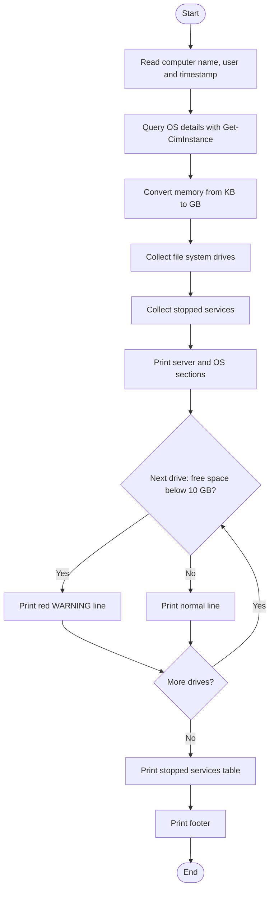

# 03 - Script Walkthrough

This page explains the final version of `scripts/GetSystemInfo.ps1` and the refinements that took it from a working script to a reusable one.

## Contents

- What the script does
- Execution flow
- Section by section
- Refinements
- Report layout

## What the script does

When run, the script:

- Identifies the computer and the logged-in user
- Records the date and time of the report
- Detects the installed operating system and the last reboot time
- Calculates total memory in GB
- Discovers file system drives and calculates free space for each
- Warns, in red, when a drive has less than 10 GB free
- Lists stopped Windows services
- Ends with a timestamped footer showing the machine name

The script only reads information. It does not change services, files or settings.

## Execution flow



## Section by section

| Script section | Key commands | Purpose |
| --- | --- | --- |
| Variables | `$env:COMPUTERNAME`, `$env:USERNAME`, `Get-Date` | Machine name, current user and report timestamp |
| Operating system | `Get-CimInstance -ClassName Win32_OperatingSystem` | OS name, last boot time and total visible memory |
| Memory conversion | `[Math]::Round($OS.TotalVisibleMemorySize / 1MB, 2)` | Converts kilobytes to gigabytes, two decimal places |
| Drives | `Get-PSDrive`, `Where-Object`, `Select-Object` | File system drives only, with Name, Used and Free |
| Stopped services | `Get-Service`, `Where-Object`, `Select-Object` | Services whose status is Stopped |
| Disk display | `foreach`, `if / else`, `Write-Host -ForegroundColor` | Checks each drive and flags those under 10 GB |
| Services display | `Format-Table -AutoSize` | Prints the stopped services as a table |
| Footer | `Write-Host` | Marks the end of the report with time and machine name |

The script is split into collect-then-display stages. Information is gathered into variables first, and the display sections only format what was already collected.

## Refinements

After the script worked, it was reviewed with one question in mind: would it still work if copied to another Windows machine? Four changes came out of that.

### Removing hard-coded values

The early version typed the computer and user names into the script:

```powershell
$computerName = "PowerShell"
$currentUser  = "Administrator"
```

On any other machine it would still report those values. Windows environment variables supply the real ones:

```powershell
$computerName = $env:COMPUTERNAME
$currentUser  = $env:USERNAME
```

### Colour with a purpose

`Write-Host -ForegroundColor` gives the output a simple hierarchy:

| Colour | Used for |
| --- | --- |
| White | Normal information |
| Green | Positive information (total memory) |
| Red | Anything that needs attention (low disk space) |
| Cyan | Section headers and footer |

The aim is speed of reading. A red low-disk line should stand out immediately during troubleshooting.

### Readable memory values

`TotalVisibleMemorySize` from `Win32_OperatingSystem` is reported in kilobytes, for example `8291272 KB`. Dividing by `1MB` and rounding gives a figure that is easier to read, such as `7.9 GB`:

```powershell
$totalMemoryGB = [Math]::Round($OS.TotalVisibleMemorySize / 1MB, 2)
```

### Footer

A closing line shows when the report finished and which machine produced it:

```powershell
Write-Host ""
Write-Host "--- Report complete:$today | Machine:$computerName ---" `
    -ForegroundColor Cyan
```

> [!NOTE]
The time format in the final script is `dd/MM/yyyy HH:mm`. Earlier notes in the lab documentation show `HH\:mm` for the same format string. Both were used during development. The final script uses the shorter form.
> 

## Report layout

The report prints four blocks. Values depend on the machine running the script.

```
========== SERVER INFORMATION ==========
Server Name : <computer name>
Reported By : <logged-in user>
Report Time : <dd/MM/yyyy HH:mm>

========== OPERATING SYSTEM ==========
Operating System : <OS caption>
Last Rebooted    : <last boot time>
Total Memory     : <GB> GB

========== DISK SPACE ==========
Drive <name>: <GB> GB
Drive <name>: <GB> GB [WARNING: LOW]      (red, below 10 GB)

========== STOPPED SERVICES ==========
Name    Status
----    ------
<stopped services listed here>

--- Report complete: <dd/MM/yyyy HH:mm> | Machine: <computer name> ---
```


 The complete terminal output of `GetSystemInfo.ps1`: all four sections, colours visible, and the footer. Blur or crop the machine and user names if you prefer not to publish them.


 GetSystemInfo.ps1 open in VS Code showing the comment header and the sectioned layout.


Next: GitHub and Copilot
