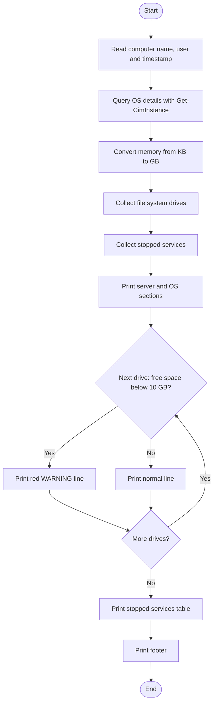

# PowerShell Server Health Report

A PowerShell home lab that builds a Windows health-check script from a first `Hello` command to a finished report. The script collects system details, checks drives for low disk space, lists stopped services and prints the results in a colour-coded layout.

Author: Clinton Kehinde | Platform: Windows 11, Windows PowerShell 5.1

## Contents

- Overview
- Objectives
- Technologies Used
- Skills Demonstrated
- Environment
- What the Script Does
- Project Scope
- Repository Structure
- Running the Script
- Validation
- Security Considerations
- Lessons Learned
- Future Improvements
- Documentation
- License
- Author

## Overview

Checking a server by hand means opening several tools and comparing values against a threshold in your head. This project automates that routine with a single script, and documents how it was built: environment setup, core scripting concepts, testing, and version control.

The report covers:

- Computer name, logged-in user and report time
- Operating system, last reboot time and total memory
- Free space on every file system drive, with a warning below 10 GB
- Services that are currently stopped

Everything in the lab was written and tested on a standard Windows 11 laptop, so it can be reproduced without server hardware.

## Objectives

- Learn PowerShell scripting from the ground up in a practical, hands-on way
- Build a health-check script an administrator could use day to day
- Practise the habits that make scripts maintainable: comments, small tested steps, no hard-coded values
- Use version control and document the work to a professional standard

## Technologies Used

| Technology | Role in the project |
| --- | --- |
| Windows 11 | Lab operating system |
| Windows PowerShell 5.1 | Scripting language and runtime (built into Windows 11) |
| Visual Studio Code | Editor, integrated terminal and debugging |
| Microsoft PowerShell extension | IntelliSense, syntax checking and script execution in VS Code |
| CIM (`Get-CimInstance`) | Operating system and memory information |
| Git and GitHub | Version control and portfolio hosting |
| GitHub Copilot (free tier) | Explanations and script review, used with the rules in GitHub and Copilot |

## Skills Demonstrated

- PowerShell scripting: variables, the pipeline, `Where-Object`, `Select-Object`, `Format-Table`
- Conditional logic with `if / else` and repetition with `foreach`
- Querying system state with `Get-CimInstance`, `Get-PSDrive` and `Get-Service`
- Environment variables to avoid hard-coded, machine-specific values
- Unit conversion and rounding (bytes and kilobytes to gigabytes)
- Readable, colour-coded console output for fast scanning
- Testing commands in isolation before adding them to a script
- Git and GitHub workflow, including enabling two-factor authentication
- Data-handling discipline when using external tools
- Technical documentation

## Environment

| Component | Specification |
| --- | --- |
| Processor | Intel Core i5 (4 cores) |
| Memory | 8 GB RAM |
| Storage | 256 GB SSD |
| Operating system | Windows 11 (64-bit) |
| PowerShell | Windows PowerShell 5.1 |
| Editor | Visual Studio Code |

Full setup steps are in Environment Setup.

## What the Script Does

`scripts/GetSystemInfo.ps1` collects information first, then displays it in four sections.



| Report section | Information |
| --- | --- |
| Server Information | Computer name, logged-in user, report time |
| Operating System | OS name, last reboot time, total memory in GB |
| Disk Space | Free space per drive, red warning below 10 GB |
| Stopped Services | Table of services with status Stopped |

The script ends with a footer showing when the report finished and which machine produced it. The script is read-only: it does not change any system setting. A line-by-line explanation is in Script Walkthrough.

## Project Scope

**In scope**

- Setting up a PowerShell development environment on Windows 11
- Core scripting concepts needed for a health check
- A working health report script and the practice scripts that led to it
- Manual testing and validation of each stage
- Using GitHub and Copilot responsibly

**Out of scope**

- Deployment to Windows Server or a multi-machine environment
- Remote execution against other computers
- Scheduling, alerting, email or file output
- Automated tests

The script is called a *server* health report because it collects the information an administrator would check on a server. It was developed and run on a Windows 11 laptop.

## Repository Structure

```
.
├── README.md
├── LICENSE
├── .gitignore
├── scripts/
│   ├── GetSystemInfo.ps1          # Final health report script
│   └── practice/
│       ├── simplelogic.ps1       # if / else practice
│       └── loops.ps1             # foreach practice
├── docs/
│   ├── 01-environment-setup.md
│   ├── 02-powershell-fundamentals.md
│   ├── 03-script-walkthrough.md
│   ├── 04-github-and-copilot.md
│   ├── 05-testing-and-validation.md
│   ├── 06-lessons-learned.md
│   └── 07-quick-reference.md
└── screenshots/
    └── README.md                  # Screenshot checklist and guidelines
```

## Running the Script

1. Clone the repository or copy `scripts/GetSystemInfo.ps1` to a local folder.
2. Open the folder in Visual Studio Code with the PowerShell extension installed.
3. Open `GetSystemInfo.ps1` and press `F5`.

The script can also be run from a PowerShell terminal in the repository folder:

```powershell
.\scripts\GetSystemInfo.ps1
```

If Windows blocks script execution, check the current policy with `Get-ExecutionPolicy`. Changing execution policy was not part of this lab. Read any script before running it.

## Validation

Each stage was tested in isolation and then in the script. The disk space figure was checked against File Explorer and matched almost exactly. The if / else logic was tested on both branches, and the service loop was tested against a stopped service to confirm it reports live status.

See Testing and Validation for the full list of tests and their limits.

## Security Considerations

- **Read-only script.** It queries system information and makes no changes.
- **No credentials.** Nothing in the repository contains passwords, keys or tokens.
- **Account protection.** Two-factor authentication is enabled on the GitHub account.
- **Workspace trust.** VS Code’s trust prompt was accepted only for a folder created locally. Folders from unknown sources should not be trusted automatically.
- **Data handling.** Credentials, infrastructure details, personal data and company information are kept out of external tools. Placeholders are used instead. See Data handling rules.
- **Reviewing generated code.** Any generated script is read, understood and tested before it is run.

## Lessons Learned

- Build in small steps and test each one.
- Run a new command alone in the terminal before adding it to a script.
- Comment as you write, not afterwards.
- Take values from the system instead of typing them in.
- Understand code from an assistant before running it.
- Keep sensitive data out of external tools.


## Documentation

| Document | Content |
| --- | --- |
| 01 Environment Setup | Hardware, software, VS Code and workspace configuration |
| 02 PowerShell Fundamentals | Variables, filtering, conditions and loops |
| 03 Script Walkthrough | How the final script works and how it was refined |
| 04 GitHub and Copilot | Version control, assistant usage and data handling rules |
| 05 Testing and Validation | Tests performed, accuracy check and limitations |
| 06 Lessons Learned | Habits and working method |
| 07 Quick Reference | Commands, operators and shortcuts |

## License

Released under the MIT License.
